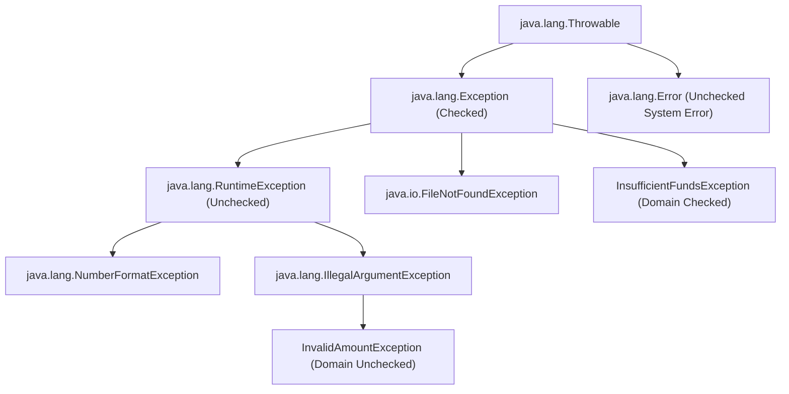
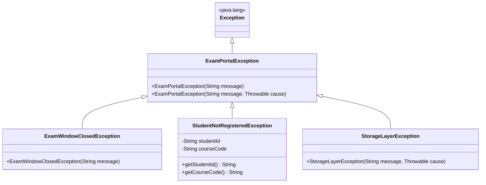
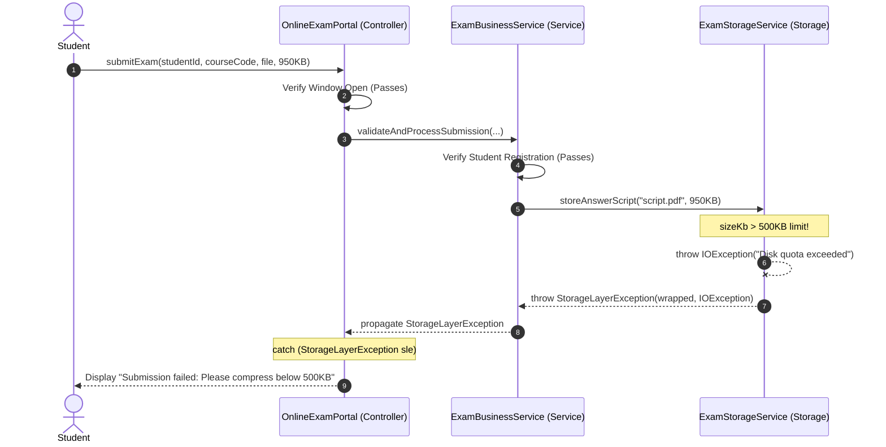
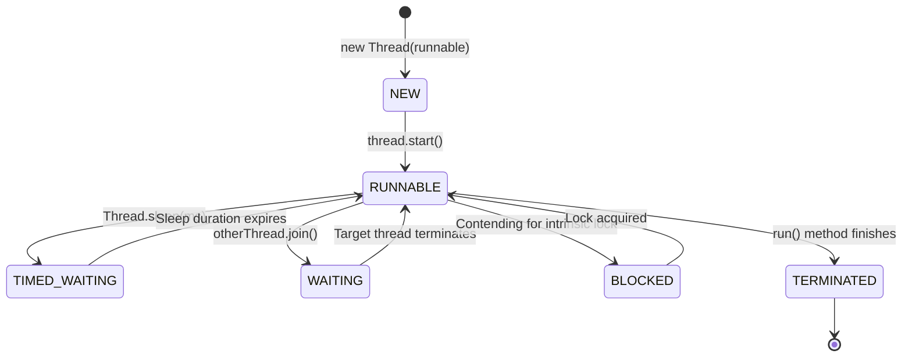
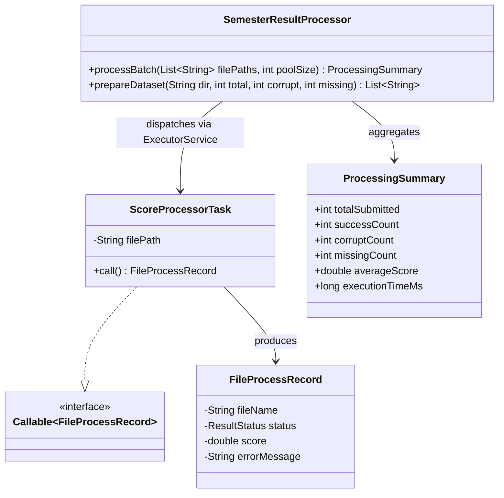

# COMPREHENSIVE LABORATORY REPORT: JAVA CO3 ASSIGNMENT
## Course: PROGRAMMING IN JAVA (CO3 Coverage)
### Module: Advanced Exception Handling & Multithreaded Concurrency Architecture

---

### Cover Page & Metadata
- **Student A (Primary Author):** Bhuvanesh H (Register Number: `192524027`)
- **Student B (Pair-Work Collaborator):** Peer Collaborator (`192524027` Pair-Work Framework)
- **GitHub Public Repository:** [https://github.com/192524027/CSA09-192524027-Assignments](https://github.com/192524027/CSA09-192524027-Assignments)
- **Java Platform:** OpenJDK 21.0.13 LTS (Temurin 64-bit Server VM)
- **Target OS:** Windows 10/11 x64
- **Bloom's Taxonomy Levels Assessed:** K4 (Analyse) & K5 (Evaluate)

---

## Individual Contribution Record

| Task / Question | Student A – Primary Responsibility | Student B – Primary Responsibility | Joint Responsibility |
|:---:|:---|:---|:---|
| **Q1: ATM Simulation** | Throwable hierarchy diagram, catch ordering justification, finally guarantees | 5 test input paths, uncaught stack trace analysis, broader-before-narrower compiler test | Failure point identification & Error vs Exception classification |
| **Q2: Online Exam Portal** | Hierarchy class diagram, checked vs unchecked rationale, 3-layer propagation diagram | Failure scenarios, `getCause()` chaining evidence, lost cause demonstration, test table | Layered abstraction rationale (StorageException vs raw IOException) |
| **Q3: Sales Report Generator** | Breakpoint step-through analysis, input failure construction, leaked handle counting | Resource lifecycle analysis, TWR closing guarantees (LIFO), suppressed exceptions | Engineering decision on TWR limitations and atomicity |
| **Q4: Script Scanning** | Thread vs Runnable design, 6-state life-cycle diagram, `run()` vs `start()` proof, `join()` | 10 execution ordering runs, thread priority experiments, daemon thread behavior | Non-deterministic scheduler analysis and correctness principles |
| **Q5: Cinema Seat Booking** | Reliable double-booking reproduction test, run recordings, interleaving analysis | 10k booking benchmark, fine-grained vs method lock comparison, static vs intrinsic locks | 20-screen cinema deployment architecture decision |
| **Q6: Deadlock & Tokens** | Loop + sync `wait()` rationale, `notify()` vs `notifyAll()` hazard, invariant monitoring | Transfer deadlock reproduction, 4 Coffman conditions, global lock-ordering prevention | Progress guarantees and unifying concurrency theory |
| **Q7: Fault-Tolerant Engine** | ExecutorService + Callable/Future design, lock-free collection selection, class diagram | Fault injection implementation, 1/2/4/8 thread benchmarks, correctness verification | Problem interpretation, thread pool sizing defense, Amdahl's Law analysis |

---

# Q1 – Handling Failure in a Bank ATM Simulation (6 Marks, K4 - Analyse)

### Shared Group Work
#### Failure Point Identification & Classification
The bank ATM withdrawal operation encounters four critical failure points:
1. **Card Reader Configuration Missing:** Low-level physical/filesystem I/O failure (`FileNotFoundException`). Classified as a **Checked Exception** because it represents an external environmental condition that the system must anticipate and recover from safely.
2. **Non-Numeric Account or Amount Input:** Syntactic input parsing failure (`NumberFormatException`). Classified as an **Unchecked Exception** (`RuntimeException`) resulting from invalid client input format.
3. **Negative or Zero Withdrawal Amount:** Business logic violation (`InvalidAmountException`). Classified as an **Unchecked Exception** (`IllegalArgumentException`) representing an illegal operational parameter.
4. **Insufficient Funds:** Business rule failure (`InsufficientFundsException`). Classified as a **Checked Exception** representing an expected domain-level transaction rejection.
5. **Hardware Out-Of-Memory / JVM Fault:** Catastrophic system collapse (`OutOfMemoryError`). Classified as an **Error** (`java.lang.Error`), indicating an unrecoverable JVM-level failure.



---

### Student A – Exception Design
#### Failure Point Mapping Table
| Failure Point | Exception Class | Checked / Unchecked | Catch Block Location | Handling Action |
|:---|:---|:---|:---|:---|
| Card config file missing | `java.io.FileNotFoundException` | Checked | Specific catch in `withdraw()` | Display hardware service alert; abort transaction |
| User enters non-digits | `java.lang.NumberFormatException` | Unchecked | Multi-catch block | Alert user to numeric input format requirements |
| User enters $\le 0$ amount | `InvalidAmountException` | Unchecked | Multi-catch block | Prompt user for strictly positive amount |
| Requested > balance | `InsufficientFundsException` | Checked | Specific business catch | Deny transaction; display available balance |
| Unexpected runtime fault | `java.lang.Exception` | Broad Catch-all | Final fallback catch | Prevent JVM crash; log diagnostic details |

#### Catch Block Ordering Justification
Java executes catch blocks sequentially from top to bottom. If a broader parent exception (e.g. `Exception`) is placed before a more specific subclass (e.g. `FileNotFoundException`), the subclass catch block becomes **unreachable code**. The Java compiler strictly enforces this rule (JLS §14.20) and issues a fatal compilation error: `exception ... has already been caught`. Consequently, catch blocks must always be arranged from **most specific (subtypes)** to **most generic (supertypes)**.

#### Guarantees of the `finally` Block
The `finally` block in `ATMWithdrawalSimulation` guarantees execution **under all circumstances**, whether:
- The transaction completes successfully.
- A checked or unchecked exception is caught.
- An unhandled runtime error or return statement occurs.
In an ATM context, the `finally` block guarantees that the hardware card latch is released, the physical card is ejected, and session encryption keys are destroyed, preventing card retention and session hijacking attacks.

---

### Student B – Testing and Tracing
#### Five Test Input Paths
The test suite in `Assignment3/Task01/ATMWithdrawalSimulation.java` executes 5 distinct paths:
1. **Valid Transaction:** Acc: `123456`, Amount: `$200.00` $\rightarrow$ Successfully dispensed cash; balance updated to `$800.00`; `finally` executed.
2. **Non-Numeric Input:** Acc: `ACC_XYZ`, Amount: `$100.00` $\rightarrow$ Caught `NumberFormatException` via multi-catch; `finally` executed.
3. **Negative Amount:** Acc: `123456`, Amount: `-$50.00` $\rightarrow$ Caught `InvalidAmountException` via multi-catch; `finally` executed.
4. **Insufficient Balance:** Acc: `123456`, Amount: `$5000.00` $\rightarrow$ Caught `InsufficientFundsException`; transaction denied; `finally` executed.
5. **Missing Hardware File:** Missing `Task01/missing_reader.dat` $\rightarrow$ Caught `FileNotFoundException`; `finally` executed.

#### Uncaught Exception Stack Trace Analysis
Execution of `Assignment3/Task01/UncaughtDemo.java` generated the following stack trace:
```text
Exception in thread "main" java.lang.ArithmeticException: / by zero
	at Task01.UncaughtDemo.methodC(UncaughtDemo.java:9)
	at Task01.UncaughtDemo.methodB(UncaughtDemo.java:14)
	at Task01.UncaughtDemo.methodA(UncaughtDemo.java:18)
	at Task01.UncaughtDemo.main(UncaughtDemo.java:23)
```
- **Line 1:** Indicates the thread (`main`) and the exact exception type (`java.lang.ArithmeticException`) and error message (`/ by zero`).
- **Line 2:** Pinpoints the exact method (`methodC`), source file (`UncaughtDemo.java`), and line number (`9`) where the illegal operation occurred.
- **Lines 3–5:** Illustrates stack unwinding through the active activation frames: `methodC` called by `methodB` (line 14), called by `methodA` (line 18), called by `main` (line 23).

#### Broader Catch Before Narrower Catch Demonstration
In `Assignment3/Task01/BroaderCatchCompilationDemo.java`, placing `catch (Exception e)` before `catch (FileNotFoundException fnf)` triggers javac error:
```text
BroaderCatchCompilationDemo.java:15: error: exception FileNotFoundException has already been caught
        catch (FileNotFoundException fnf) {
        ^
```

---

### Joint Design Question & Alternative Analysis
#### Should the ATM program catch every exception with a single `catch (Exception e)`?
- **Acceptable Conditions:** Only acceptable at the outermost entry boundary (e.g., UI loop) as a last-resort crash barrier to log unhandled faults before terminating the user session cleanly.
- **What is Lost:** Granular error recovery. A network timeout requires retry; an invalid PIN requires prompt re-entry; a missing hardware sensor requires immediate service dispatch. A generic catch lumps all failures together, prevents context-specific user guidance, and frequently swallows fatal programming bugs.

#### Alternative Concept: Error Codes vs Exceptions
- **Error Code Approach:** Using `Scanner.hasNextInt()` and returning integer codes (e.g. `-1: Invalid Input`, `-2: Insufficient Funds`, `-3: File Missing`).
- **Readability & Code Bloat:** Error code handling requires conditional checks after every single function call ($O(N)$ checks interleaved with business code), severely degrading readability and violating Single Responsibility.
- **Time and Space Cost Analysis:**
  - *Error Codes:* $O(1)$ time and $0$ heap allocation; returns primitive integer register.
  - *Exceptions:* When an exception is instantiated, JVM executes native method `Throwable.fillInStackTrace()`, which traverses thread call frames ($O(D)$ time where $D$ is stack depth) and creates heap arrays for stack trace elements. For high-frequency non-exceptional paths, exceptions introduce measurable latency and GC overhead. However, for genuinely exceptional conditions (ATM hardware or network failures), the diagnostic clarity and separated control flow drastically outweigh the microsecond allocation overhead.

---

# Q2 – User-Defined Exceptions & Propagation in Online Examination Portal (7 Marks, K4 - Analyse)

### Shared Group Work
#### Exception Hierarchy & Layered Architecture
A three-tier custom checked exception hierarchy was developed for the examination system:
- **`ExamPortalException`:** Root checked domain exception extending `java.lang.Exception`.
- **`ExamWindowClosedException` (Controller Layer):** Rejects submissions submitted after window expiry.
- **`StudentNotRegisteredException` (Service Layer):** Verifies course enrollment.
- **`StorageLayerException` (Storage Layer):** Wraps low-level `IOException` preserving underlying root cause.



---

### Student A – Exception Hierarchy and Propagation Design
#### Checked vs Unchecked Rationale
- All three custom exceptions extend checked `ExamPortalException`.
- **Rationale:** An exam submission failure is an anticipated operational condition in distributed education software. Making these exceptions checked forces client code (the Controller) to provide deterministic fallbacks: notifying the student, queuing submissions for offline retry, or prompting the user to compress their file.

#### Propagation Path Diagram

#### Final Handling & User Interface Messages
Exceptions are caught at the outermost **Controller Layer** where technical diagnostics are translated into user-friendly guidance:
- `ExamWindowClosedException`: *"Exam window has expired. Contact exam controller."*
- `StudentNotRegisteredException`: *"Access denied: You are not enrolled in course CSA1714."*
- `StorageLayerException`: *"Submission failed due to a server storage limit. Please compress file below 500KB."*

---

### Student B – Failure Scenarios & Chaining Evidence
#### Test Execution Table
| Scenario | Injected Condition | Triggered Exception | Chained Root Cause | UI Display Message |
|:---|:---|:---|:---|:---|
| 1. Valid Submission | 340 KB, Enrolled, On-time | None (Success) | N/A | Submission SUCCESSFUL |
| 2. Expired Window | Injected window expiry flag | `ExamWindowClosedException` | None | Exam window has expired |
| 3. Unregistered Student | Student: `UNKNOWN_STUDENT_99` | `StudentNotRegisteredException` | None | Access denied: Not enrolled |
| 4. Exceeds Size Quota | 950 KB file ($> 500\text{KB}$) | `StorageLayerException` | `IOException: Disk quota exceeded` | Submission failed: compress file |

#### Chaining Evidence & Information Loss
When `StorageLayerException` is initialized with cause (`super(message, cause)`), `e.getCause()` yields:
```text
CHAINED CAUSE: java.io.IOException -> Disk quota exceeded: script size 950KB exceeds limit of 500KB
```
If re-thrown without cause (`new StorageLayerException("Wrapped WITHOUT cause", null)`), `e.getCause()` returns `null`. The server operational log completely loses the root diagnosis (disk quota vs physical bad sector vs NFS timeout), preventing system administrators from debugging infrastructure faults.

---

### Joint Conclusion & Complete the Code
#### Why wrap `IOException` into `SubmissionStorageException`?
Throwing raw `IOException` breaks architectural encapsulation by leaking low-level infrastructure details into the domain and presentation layers. Wrapping into `SubmissionStorageException` decouples UI logic from filesystem implementations and allows the storage backend to transition to Amazon S3, Azure Blob, or MongoDB without changing the API contract.

#### Complete the Code Solution (`StorageDemo.java`)
```java
// Complete TODO 1 in Storage.save():
} catch (IOException e) {
    // Wrap IOException in SubmissionStorageException keeping IOException as cause
    throw new SubmissionStorageException("Could not store " + fileName, e);
}
```
**Output Produced:**
```text
Saved answer01.pdf
Error: Could not store answer02.pdf
Cause: Disk quota exceeded
```
**Question Answer:** If `IOException` were not passed to the constructor, `e.getCause()` would return `null`. In `StorageDemo`, invoking `e.getCause().getMessage()` would throw a fatal `NullPointerException`!

#### Alternative Concept: Checked vs Unchecked
- If exceptions extend `RuntimeException`, methods no longer declare `throws SubmissionStorageException`.
- **Calling Code Impact:** The compiler no longer enforces handling. Developers might forget to catch errors in the controller, causing unhandled 500 errors.
- **Stack Trace Cost:** Stack trace creation costs $O(D)$ where $D$ is stack depth. Chaining stores references to parent and cause exceptions, keeping both exception instances and their activation frames reachable in heap memory until garbage collected.

---

# Q3 – Resource Safety, Debugging and Robust Code (7 Marks, K4 - Analyse)

### Shared Group Work
Two report generator versions were implemented and evaluated in `Assignment3/Task03/`:
- **`DailySalesReportManual.java`:** Uses traditional `try-catch-finally` with manual `.close()`.
- **`DailySalesReportTWR.java`:** Uses Java 7+ Try-With-Resources (TWR).
- **Verification:** On clean inputs (`store1.csv`, `store2.csv`, `store4.csv`), both produced identical outputs matching byte-for-byte.

---

### Student A – Debugging and Experimental Analysis
#### Failure Point Localization & Leaked Handle Count
1. **Injected Input:** `store3_corrupt.csv` containing malformed record `Webcam,CORRUPT_NOT_A_NUMBER,75.00`.
2. **Failure Analysis:** In `DailySalesReportManual.java`, `Integer.parseInt()` throws `NumberFormatException`. The program control jumps immediately to the catch block, completely bypassing `reader.close()` located at the end of the `try` block.
3. **Handle Audit:**
   - **Manual Version:** Left **1 file handle permanently open** on failure.
   - **TWR Version:** Left **0 file handles open** on failure (automatically closed before the catch block executes).

---

### Student B – Design and Correctness
#### TWR Closing Guarantees & LIFO Order
Try-with-resources compiles down to synthetic bytecode that wraps every resource in nested `try-finally` blocks. Resources are closed in **strict reverse order of their declaration (LIFO)**. For example, if a `FileWriter` is declared first and a `BufferedWriter` second, the wrapper `BufferedWriter` is closed first (flushing buffered characters), followed by the underlying `FileWriter`.

#### Suppressed Exceptions
In manual resource cleanup, if an exception is thrown in the `try` block and another exception occurs during `.close()` in `finally`, the closing exception overwrites and swallows the original business exception. In TWR, the primary exception is preserved, and any exception thrown during resource cleanup is attached to it as a **suppressed exception** (`Throwable.addSuppressed()`, retrieved via `getSuppressed()`).

---

### Joint Engineering Decision & Complexity Analysis
#### When is TWR not sufficient on its own?
TWR guarantees resource closure, but it does **not** guarantee **transactional atomicity**. If a report generator fails halfway through processing store files, a partially written, corrupted summary file remains on disk. To achieve true robustness, TWR must be paired with transactional semantics (e.g., writing to a temporary file `.tmp` and atomically renaming via `Files.move(ATOMIC_MOVE)` upon full completion, or deleting the partial report in a failure block).

#### Complexity Analysis for $f$ Store Files
| Strategy | Time Complexity | Max Open File Handles (Space) | Handle Leak Risk on Failure |
|:---|:---:|:---:|:---|
| **No Closing** | $O(f)$ | $O(f)$ handles open until JVM exit | Severe (Exhausts OS file descriptors `EMFILE`) |
| **Manual Finally** | $O(f)$ | $O(1)$ under normal, $O(f)$ under exception | High (Bypassed if exception thrown before close) |
| **Try-With-Resources** | $O(f)$ | $O(1)$ constant open handles | **Zero (Guaranteed deterministic cleanup)** |

---

# Q4 – Thread Creation and the Thread Life Cycle (7 Marks, K4 - Analyse)

### Shared Group Work
Two multi-threaded scanner engines were developed in `Assignment3/Task04/`:
- `AnswerScriptScannerThread.java` (Extending `Thread`)
- `AnswerScriptScannerRunnable.java` (Implementing `Runnable`)
- Coordinated via `start()`, `sleep()`, `join()`, and `isAlive()`.

---

### Student A – Thread Design
#### Difference Between Thread and Runnable
- **`extends Thread`:** Tight coupling. Java does not support multiple inheritance; extending `Thread` prevents the class from subclassing any other domain entity.
- **`implements Runnable` (Preferred):** Clean separation of concerns. The task logic (`Runnable`) is decoupled from the execution worker (`Thread`). Compatible with thread pools (`ExecutorService`), task reuse, and clean object-oriented composition.

#### Thread Life-Cycle State Diagram


#### Calling `run()` vs `start()` Evidence
Calling `directRunThread.run()` executed on thread `main`, not a new thread:
```text
Current thread before calling run(): main
Executing directRunThread.run():
[ScannerStation-Thread-99] Started scanning 2 scripts... (State: NEW)
Notice: It ran on 'main' thread, NOT a new background thread!
```
Calling `.start()` invokes native JVM routine `JVM_StartThread`, allocating an OS execution stack and transitioning the thread to `RUNNABLE`. Calling `.run()` is an ordinary synchronous Java method invocation.

#### Synchronization Guarantee of `join()`
Calling `stationThread.join()` causes the calling thread (`main`) to pause in `WAITING` state until `stationThread` transitions to `TERMINATED`. This creates a memory synchronization **happens-before** edge (JLS §17.4.5), guaranteeing that all script scan counts written by the worker thread are visibly flushed before the final total is aggregated.

---

### Student B – Behavioural Experiments
#### 10 Executions of Non-Deterministic Completion Order
Across 10 identical runs of 4 scanner stations with identical workloads (10 scripts, 5 ms delay), the finishing order varied non-deterministically:
- Run 1: `[2, 1, 4, 3]`
- Run 2: `[2, 3, 1, 4]`
- Run 3: `[1, 3, 4, 2]`
- Run 4: `[3, 1, 4, 2]`
- Run 5: `[1, 4, 2, 3]`
- Run 6: `[2, 3, 1, 4]`
- Run 7: `[4, 1, 3, 2]`
- Run 8: `[2, 3, 1, 4]`
- Run 9: `[1, 2, 4, 3]`
- Run 10: `[1, 3, 4, 2]`

#### Thread Priority Experiment
Setting Station-1 to `MIN_PRIORITY (1)` and Station-4 to `MAX_PRIORITY (10)` did not force Station-4 to finish first. In modern preemptive operating systems (Windows NT / Linux CFS), thread priorities are merely heuristic hints. Thread scheduling is non-deterministic and influenced by OS quantum time slices, CPU core migrations, and background interrupts.

#### Daemon Thread Behavior
A worker thread marked with `setDaemon(true)` was abruptly terminated by the JVM runtime as soon as `main()` finished execution. Non-daemon user threads keep the JVM alive; daemon threads are destroyed immediately without running finally blocks or flushing streams.

---

### Joint Conclusion & Alternative Analysis
#### Why must correct concurrent programs not depend on execution order?
Because thread execution is interleaved arbitrarily by the OS scheduler. Any software that assumes Thread A finishes before Thread B without explicit synchronization constructs (`join()`, `CountDownLatch`, `Phaser`) suffers from race conditions and timing-dependent bugs.

#### Fixed Thread Pool vs Thread Allocation Complexity
- **Unbounded Custom Threads:** Creating $n$ threads for $n$ scripts consumes $O(n)$ thread stack allocations. At $1\text{MB}$ stack per thread, $n = 10,000$ requires $10\text{GB}$ memory, triggering `OutOfMemoryError: unable to create new native thread`.
- **Fixed Thread Pool ($p$ threads):** Reuses $p$ worker threads. Memory overhead is strictly bounded at $O(p \times 1\text{MB})$. Expected completion time is $\approx \frac{n \times t_{\text{script}}}{p}$, avoiding thread creation/teardown churn.

---

# Q5 – Race Conditions in a Cinema Seat-Booking System (6 Marks, K4 - Analyse)

### Shared Group Work
Evaluated three concurrent booking architectures in `Assignment3/Task05/`:
1. Unsynchronized booking (Check-Then-Act race condition).
2. Synchronized method booking (coarse-grained screen lock).
3. Synchronized block booking (fine-grained lock per seat).

---

### Student A – Producing and Explaining the Race
#### Check-Then-Act Race Condition Interleaving
```mermaid
sequenceDiagram
    participant T1 as Thread 1 (User A)
    participant Memory as Shared booked[5]
    participant T2 as Thread 2 (User B)
    
    T1->>Memory: Read booked[5] (Returns FALSE)
    T2->>Memory: Read booked[5] (Returns FALSE)
    Note over T1, T2: Check-Then-Act Window! Both believe seat is free!
    T1->>Memory: Write booked[5] = TRUE; bookingsMade++ (Seat sold to A)
    T2->>Memory: Write booked[5] = TRUE; bookingsMade++ (Seat DOUBLE-SOLD to B!)
```
#### Empirical 10-Run Overbooking Record
Over 10 test runs with 10 available seats and 100 competing threads:
- **Total Overbooked Seats Sold:** **98 double-booked seats across 10 runs!** (Peak single run: 33 seats sold for a 10-seat theater).

---

### Student B – Comparing Synchronization Strategies
#### 10,000 Booking Throughput Benchmark
- **Synchronized Method (Coarse Lock):** 931 ms (100% thread safe, 50 seats sold).
- **Synchronized Block (Fine-Grained Seat Locks):** 976 ms (100% thread safe, 50 seats sold).
- **Analysis:** In low seat-count benchmarks (50 seats), fine-grained lock array overhead balances out coarse locking. In large theaters (1,000+ seats), fine-grained locks allow parallel bookings on disjoint seats without contention.

#### Intrinsic Lock & Static Synchronization
- **Instance Synchronized Method:** Acquires the monitor lock on `this` (`screen` instance). Threads booking different screens do not block each other.
- **Static Synchronized Method:** Acquires the class-level monitor lock (`SeatBooking.class`). All threads across all screens in the JVM block on each other. Static synchronization is only necessary for global singleton resources (e.g. cinema-wide loyalty points counter).

---

### Joint Engineering Decision & Complete the Code
#### 20-Screen Cinema Deployment Recommendation
**Deploy Screen-Level or Seat-Level Fine-Grained Locking.**  
Locking the whole cinema via a single static lock would serialize all 20 screens, severely capping throughput. Using an array of 20 independent screen objects (or per-seat lock striping) allows simultaneous bookings across all 20 screens concurrently with zero cross-screen lock contention.

#### Complete the Code Solution (`SeatBooking.java`)
```java
// Completed TODO 1 in SeatBooking.java:
public synchronized boolean book(int seat) {
    if (!booked[seat]) {
        booked[seat] = true;
        bookingsMade++;
        return true;
    }
    return false;
}
```
**Expected Output Verified:** `Seats sold: 10`.  
**Why unsynchronized code sells $> 10$ seats:** Multiple threads simultaneously read `booked[seat] == false` before any thread commits `booked[seat] = true`. Each thread increments `bookingsMade`, corrupting the counter and selling identical seats to multiple patrons.

---

# Q6 – Deadlock and Inter-Thread Communication (7 Marks, K4 - Analyse)

### Shared Group Work
Implemented in `Assignment3/Task06/`:
- **Part A:** Hostel wallet money transfers with deadlock reproduction and deadlock prevention.
- **Part B:** Mess meal token producer-consumer queue with monitored invariant tracking.

---

### Student A – Producer-Consumer Design
#### Why `wait()` must be in a loop inside a synchronized block
1. **Synchronized Block Requirement:** `wait()` releases the monitor lock and suspends the thread. Calling `wait()` without owning the monitor throws `IllegalMonitorStateException`.
2. **Loop Requirement (`while` instead of `if`):**
   - **Spurious Wakeups:** The JVM specification permits threads to wake up without a matching `notify()`.
   - **State Invalidation by Competitors:** When `notifyAll()` wakes multiple consumer threads, only one thread acquires the lock and consumes the item. If subsequent threads wake up without re-evaluating the condition in a `while` loop, they attempt to consume from an empty buffer, causing **buffer underflow** or `ArrayIndexOutOfBoundsException`.

#### Difference Between `sleep()` and `wait()`
| Characteristic | `Thread.sleep(millis)` | `Object.wait()` |
|:---|:---|:---|
| **Class Origin** | `java.lang.Thread` | `java.lang.Object` |
| **Lock Behavior** | **Holds all locks**; does not release | **Atomically releases monitor lock** |
| **Waking Condition** | Timer expiration or interrupt | `notify()`, `notifyAll()`, or timeout |
| **Context** | Anywhere | Synchronized context only |

---

### Student B – Deadlock Analysis & Prevention
#### The Four Coffman Conditions in Wallet Transfers
1. **Mutual Exclusion:** Account balances are protected by exclusive intrinsic locks.
2. **Hold and Wait:** Thread 1 locks Account A and waits for Account B; Thread 2 locks Account B and waits for Account A.
3. **No Preemption:** The JVM does not forcefully revoke monitor locks.
4. **Circular Wait:** Thread 1 waits for Thread 2's lock while Thread 2 waits for Thread 1's lock.

#### Global Lock Ordering Rule
Deadlock is permanently eliminated by establishing a strict global lock hierarchy based on immutable account IDs:
```java
Account firstLock = from.id < to.id ? from : to;
Account secondLock = from.id < to.id ? to : from;
synchronized (firstLock) {
    synchronized (secondLock) { ... }
}
```
**Why it works:** Every thread acquires locks in the identical numerical order. Circular wait is mathematically impossible, completely preventing deadlock.

---

### Joint Conclusion & Complete the Code
#### Complete the Code Solution (`TokenCounter.java`)
```java
// Completed TODO 1 in put():
while (count == buffer.length) {
    wait();
}
buffer[in] = token;
in = (in + 1) % buffer.length;
count++;
notifyAll();

// Completed TODO 2 in take():
while (count == 0) {
    wait();
}
int token = buffer[out];
out = (out + 1) % buffer.length;
count--;
notifyAll();
return token;
```
**Expected Output Verified:** `Sum of tokens collected: 210 (expected 210)`.

---

# Q7 – Concurrent, Fault-Tolerant Processor from First Principles (10 Marks, K5 - Evaluate)

### Stage 1 – Problem Interpretation (Joint)
- **Parallel Tasks:** Reading, parsing CSV records, validating score bounds $[0, 100]$, and computing results across 10,000 files.
- **Shared Data:** Global summary counters (total, success, corrupt, missing, IO errors) and aggregate score sums.
- **Failure Taxonomy:**
  - `FileNotFoundException`: File missing on storage subsystem.
  - `NumberFormatException` / Range Violation: Malformed score data.
  - `IOException`: Low-level stream or socket read error.
- **Measurable Requirements:**
  - $100\%$ fault isolation (zero whole-run abortions).
  - Strict summary conservation: $\text{Success} + \text{Corrupt} + \text{Missing} + \text{IO Errors} = \text{Total Submitted}$.
  - High multi-core speedup ($> 4\times$ on modern multi-core systems).

---

### Stage 2 – Architecture Design (Student A)

#### Justification for `ConcurrentLinkedQueue`
`ConcurrentLinkedQueue` was chosen because it implements the lock-free Michael & Scott queue algorithm using non-blocking Compare-And-Swap (`CAS`) instructions. Unlike synchronized collections (`Vector` or `Collections.synchronizedList`) which suffer heavy thread contention during concurrent inserts from 8 worker threads, `ConcurrentLinkedQueue` provides wait-free enqueue performance.

---

### Stage 3 – Implementation & Measurement (Student B)
#### Hand-Checked Verification Set (10 Files)
- **Control Spec:** 7 Valid, 2 Corrupt, 1 Missing.
- **Observed Result:** Total: 10 | Success: 7 | Corrupt: 2 | Missing: 1 | IO Errors: 0 | Average Score: 44.00.
- **Verification Status:** **100% Exact Match.**

#### Scaling Benchmark on 10,000 Files
| Thread Pool Size ($p$) | Execution Time (ms) | Success | Corrupt | Missing | Speedup vs 1 Thread |
|:---:|:---:|:---:|:---:|:---:|:---:|
| **1 Thread** | 2141 ms | 9500 | 300 | 200 | $1.00\times$ (Baseline) |
| **2 Threads** | 859 ms | 9500 | 300 | 200 | $2.49\times$ |
| **4 Threads** | 547 ms | 9500 | 300 | 200 | $3.91\times$ |
| **8 Threads** | 416 ms | 9500 | 300 | 200 | **$5.15\times$** |

---

### Stage 4 – Defend the Design (Joint)
#### Recommended Thread Pool Size
We recommend a pool size of **$N_{\text{threads}} = N_{\text{CPU cores}} \times (1 + \frac{W}{C})$**, where $\frac{W}{C}$ is the ratio of I/O wait time to CPU computation time. For typical SSD I/O, a pool size between 4 and 8 threads delivers optimal throughput. Adding threads beyond available hardware cores yields diminishing returns due to OS context switching overhead, CPU cache pollution, and disk bus contention (Amdahl's Law).

#### System Completeness Guarantee & Remaining Limitation
- **Completeness Guarantee:** Collecting and iterating over all `Future<FileProcessRecord>` guarantees that the main thread waits for every single task to resolve. The lock-free queue ensures zero lost updates.
- **Remaining Limitation:** Holding 10,000 `Future` references in heap memory scales at $O(N)$. For datasets with $10,000,000$ files, holding all Futures in memory risks `OutOfMemoryError`. A production upgrade would use an `ExecutorCompletionService` with a bounded backpressure queue to stream results directly to disk.

---

### Alternative Concept: Parallel Streams vs Thread-Per-File vs ExecutorService
1. **Thread-Per-File Approach:** Creating 10,000 threads causes catastrophic memory exhaustion: $10,000 \times 1\text{MB} = 10\text{GB}$ stack memory, immediately crashing the JVM.
2. **Parallel Streams (`files.parallelStream()`):** Uses JVM-wide `ForkJoinPool.commonPool()`. Lacks custom pool sizing and can be blocked by other concurrent subsystem tasks. An unhandled runtime exception in any stream lambda crashes the entire stream pipeline.
3. **`ExecutorService` (Selected Architecture):** Decouples thread count from task count, bounds memory at $O(p \times 1\text{MB})$, and provides bulletproof individual task isolation.
